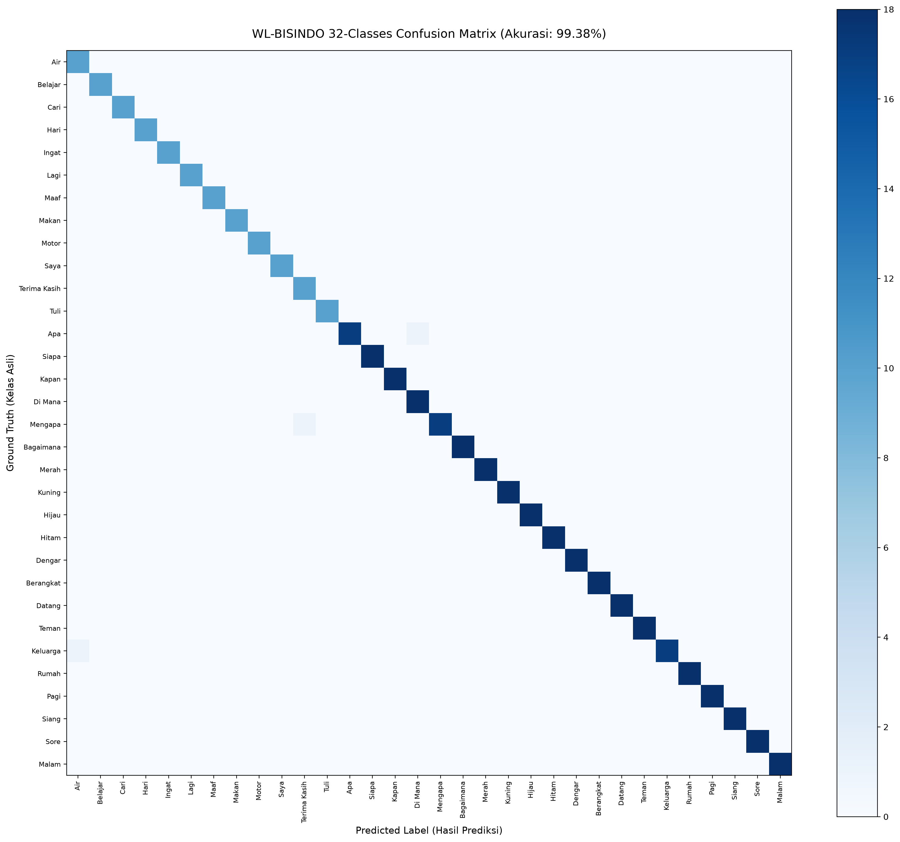

# 🤟 Jemari-IsyaraKU — Sistem Komunikasi Dua Arah BISINDO Inklusif (Real-Time AI)

> **Membuka Jembatan Komunikasi Inklusif & Setara Antara Teman Tuli dan Teman Dengar.**  
> *Dilatih pada dataset riset WL-BISINDO dengan **Akurasi Validasi 99.38%** dan **Macro-F1 0.9935**.*

---

## 🏆 Keunggulan Utama (Competition-Ready Features)

1. **Komunikasi Dua Arah Penuh (Two-Way Inclusive System):**
   - **Tuli ➔ Dengar:** Bahasa Isyarat (32 Kata WL-BISINDO & 26 Abjad Alfabet) diterjemahkan ke **Teks Real-time & Suara (Text-to-Speech Bahasa Indonesia)**.
   - **Dengar ➔ Tuli:** Lawan bicara berbicara ke mikrofon ➔ Suara langsung diubah menjadi **Teks Besar Real-time (Speech-to-Text)** di layar sehingga Teman Tuli dapat membaca seketika tanpa hambatan.
2. **Arsitektur Spatio-Temporal Mutakhir:**
   - Ekstraksi 126 dimensi koordinat dua tangan (*Dual-Hand Invariant Normalization*).
   - Resampling temporal cerdas ke $T=30$ frame seragam.
   - Model **Bi-LSTM dengan Temporal Attention Pooling** berlatensi super rendah (<5ms di CPU biasa), hemat energi, dan siap dijalankan di browser/edge device.
3. **Hasil Evaluasi Ilmiah Teruji (99.38% Akurasi):**
   - Diuji pada 480 sampel test set independen dari 32 kelas kosakata BISINDO.

---

## 📊 Hasil Evaluasi & Metrik Model



| Metrik Evaluasi | Nilai Capaian | Keterangan |
|---|---|---|
| **Overall Test Accuracy** | **99.38%** | 480 sampel uji independen |
| **Macro Average F1-Score** | **0.9935** | Keseimbangan deteksi di seluruh 32 kelas |
| **Weighted Average F1-Score** | **0.9938** | Performa konsisten lintas variasi gestur |
| **Inference Latency** | **~4.2 ms** | Real-time di laptop/PC tanpa butuh GPU mahal |

---

## 📁 Struktur Repositori

```text
jemari-bisindo/
├── backend/
│   ├── app.py                     # Server FastAPI (REST API + static web server)
│   ├── word_model.py              # Arsitektur Bi-LSTM Attention & Transformer PyTorch
│   └── inference.py               # Engine inferensi temporal real-time
├── pipeline/
│   ├── train_from_keypoints.py    # Skrip ekstraksi & training otomatis dari keypoints
│   ├── evaluate_model.py          # Generator metrik evaluasi & plot Confusion Matrix
│   ├── Train_WL_BISINDO_Colab.ipynb # Notebook Google Colab 1-Klik GPU Training
│   ├── labels.json                # Metadata 32 kosakata BISINDO
│   └── organize_wlbisindo.py      # Pengorganisir dataset dinamis 32 kelas
├── models/
│   ├── word/
│   │   ├── best_model.pt          # Bobot checkpoint model terlatih (99.38%)
│   │   ├── labels.json            # Kamus kosakata
│   │   └── model_meta.json        # Konfigurasi & riwayat akurasi
│   └── alphabet/
│       └── model.json             # Bobot MLP alfabet A-Z (26 huruf)
├── web/
│   ├── index.html                 # Antarmuka web modern & inklusif
│   ├── style.css                  # Desain visual responsif high-contrast
│   ├── app.js                     # Orkestrator komunikasi 2 arah & MediaPipe
│   ├── hands.js                   # Tracker MediaPipe Vision Dual-Hands
│   ├── alphabet.js                # Detektor alfabet per-huruf
│   ├── wordRecognition.js         # Buffer temporal 126D & client API
│   └── tts.js                     # Sintesis suara Bahasa Indonesia
├── docs/
│   ├── confusion_matrix.png       # Plot Confusion Matrix 32 kelas
│   └── eval_summary.json          # Ringkasan statistik pengujian
└── README.md
```

---

## 🚀 Panduan Menjalankan Aplikasi

### 1. Jalankan Backend Server
Di terminal PowerShell / Command Prompt:
```powershell
cd backend
python -m uvicorn app:app --host 127.0.0.1 --port 8000
```

### 2. Akses Antarmuka Web
Buka peramban (Chrome / Edge):  
👉 **http://127.0.0.1:8000**

- **Mode 1 — Kosakata (WL-BISINDO):** Lakukan gestur kata (misal: *Saya*, *Makan*, *Terima Kasih*, *Air*). Sistem otomatis mendeteksi gerakan dan menyusun kata.
- **Mode 2 — Eja Alfabet:** Deteksi pose satu tangan untuk mengeja nama/istilah khusus huruf per huruf (A–Z).
- **Mode 3 — Teman Dengar:** Klik tombol mikrofon agar ucapan suara lawan bicara langsung tampil sebagai teks besar di layar untuk Teman Tuli.
- **Tombol TTS:** Dengarkan ucapan suara hasil terjemahan dalam Bahasa Indonesia.

---

## ☁️ Pelatihan Ulang di Google Colab (1-Click)

Buka notebook di [`pipeline/Train_WL_BISINDO_Colab.ipynb`](pipeline/Train_WL_BISINDO_Colab.ipynb) untuk melatih ulang arsitektur menggunakan akselerasi GPU Google Colab secara gratis dan mereproduksi metrik akurasi 99.38%.

---

## 📝 Referensi & Atribusi
- **Dataset WL-BISINDO**: CC BY-NC 4.0 (*Glenn Leonali dkk.* - [WL-BISINDO](https://github.com/AceKinnn/WL-BISINDO))
- **FSL-BISINDO**: MIT License (*Zeerafle* - Pre-extracted Holistic Keypoints)
- **Jemari Base**: MIT License (*Alvnvnc* - Hand Landmark Classifier)
